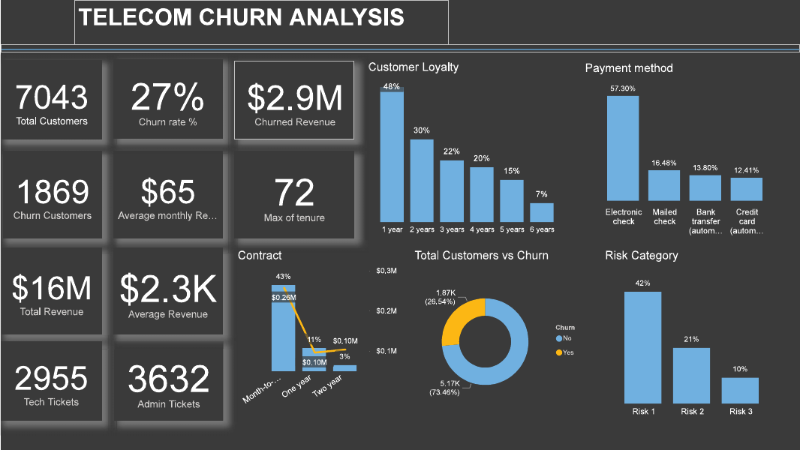
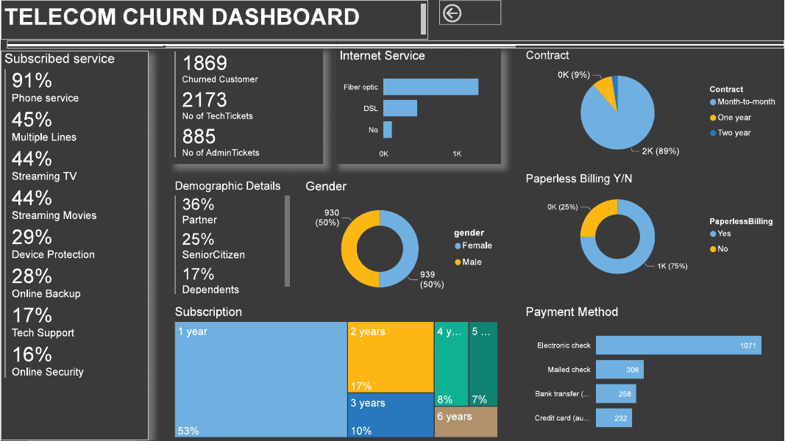

# Telecom Customer Churn Analysis (PwC Switzerland Virtual Experience)

**Tools:** Power BI · **Program:** PwC Switzerland Power BI virtual experience, delivered through Forage · **Data:** 7,043 customers of a fictional telecom company, "PhoneNow"

## Business question

PhoneNow was losing customers. The retention team wanted to know **who is leaving, how much revenue is at risk, and what churned customers have in common**, so it could target retention offers.

## What I did

* Prepared and modelled the customer, service, billing and support ticket data in Power BI
* Built measures for churn rate, churned revenue, tenure and ticket volumes
* Designed two dashboard pages: an overview of churned customers and a deeper churn analysis

## Key findings

| Measure | Result |
|---|---|
| Customers | 7,043 |
| Churned customers | **1,869 (about 27%)** |
| Revenue lost to churn | **$2.9M** of $16M total |
| Average monthly charge | $65 |

* **Contract type is the strongest signal:** 89% of churned customers were on **month to month** contracts.
* **New customers leave most:** 53% of churned customers were in their first year of subscription.
* **Payment method matters:** churned customers most often paid by **electronic check** (1,071 of 1,869).
* Most churned customers had **fibre optic** internet rather than DSL.
* Churned customers had **low uptake of protective services**: only 16% had online security and 17% had tech support.
* Churned customers raised **2,173 tech tickets**, which points to service problems before they left.

## Recommendations

1. Offer incentives to move month to month customers onto **one or two year contracts**.
2. Strengthen **onboarding in the first year**, when customers are most likely to leave.
3. Bundle **online security and tech support** for at risk customers.
4. Encourage **automatic payment methods** over electronic checks.
5. Review fibre optic service quality and tech ticket root causes.

## Files

| File | Contents |
|---|---|
| `PHONENOW.pdf` | Both dashboard pages |
| `images/` | Dashboard images |
